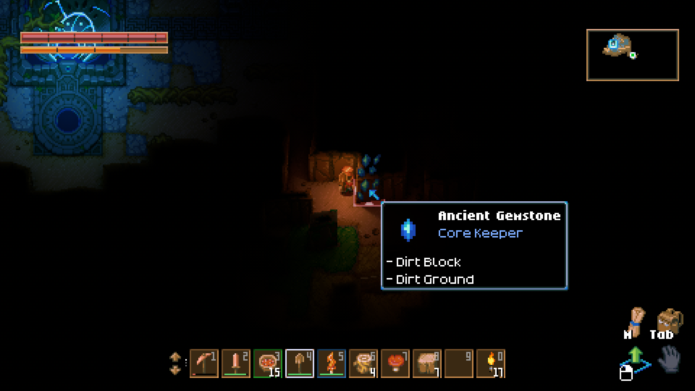

<h1 align="center">Jade HUD</h1>

<em>Hold ALT, point at anything, and Core Keeper tells you what it is.</em>

---

Ever stared at a mysterious glowing thing in the dark and wondered what on earth it was? Jade HUD is a tiny hover box in the style of the Minecraft mod Jade. Point your mouse at something, hold **ALT**, and a cosy little card pops up beside the cursor.

## What it shows

- **The name** of whatever is under your cursor, with its icon.
- **Where it comes from**: *Core Keeper* in blue, or the name of the mod that added it.
- **Everything else on that tile**, like the dirt block and the ground under an ore.
- **Plant growth**: which stage a plant is at and how long until the next one.
- **Mob health**, as `Health: 12/20`.

It looks like the game's own item tooltip, so it feels like part of the game.

## How to use it

1. Hover over something.
2. Hold **ALT**.
3. That's it!

The box hides while a menu is open or you are pointing at a UI slot.

## Good to know

- It runs on your side only. Nobody else needs it, and it works when you join a server.
- Plant timers work in single player and when you host. In someone else's world the time may show as "unknown".
- Tall walls are drawn over the tile behind them, so Jade HUD picks the wall when you point at its top.

## Install

Subscribe on **mod.io** or the **Steam Workshop**, then start the game.

Building it yourself? Copy the `JadeHud` folder into the `Assets` folder of the [Core Keeper Mod SDK](https://github.com/Pugstorm/CoreKeederModSDK), open it in Unity 6000.0.59f2 and build from the PugMod window.

## Plans

Chest contents and furnace progress are next on the list.

---

Made with love for the Core Keeper community.

